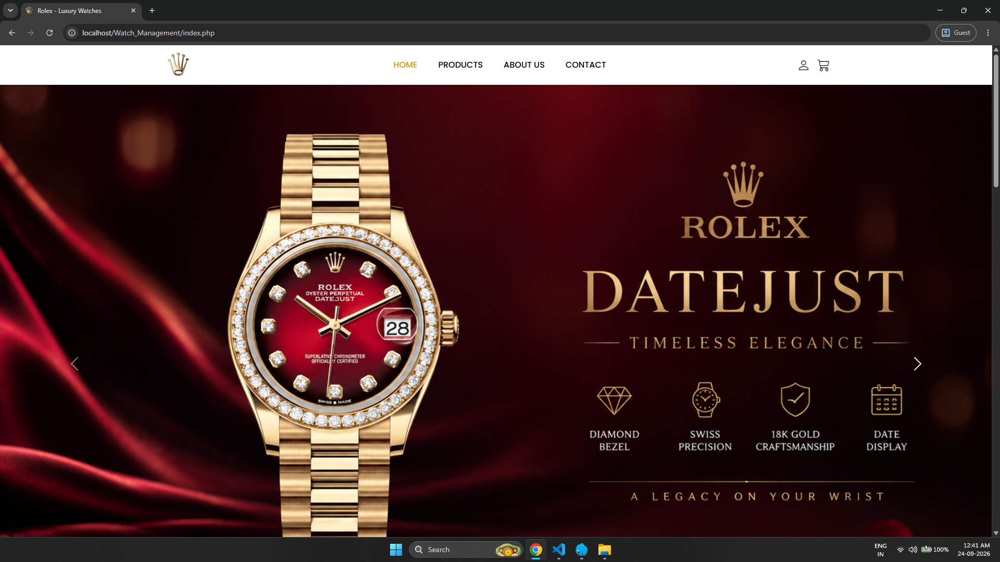

# Watch Management System

A PHP and MySQL based Watch Management / E-commerce System.

## Project Preview

## Technologies Used

- PHP
- MySQL
- HTML5
- CSS3
- JavaScript
- Bootstrap
- Ajax
- XAMPP

## Features

- User Registration & Login
- Watch Listing
- Watch Search
- Watch Filtering
- Shopping Cart
- Order Management
- Invoice View & Download
- Admin Dashboard
- Watch Management
- Stock Management

## Database

The database SQL file is available in:

`database/watch_management.sql`

## Installation

1. Install XAMPP.
2. Copy the project into `htdocs`.
3. Start Apache and MySQL.
4. Create a database named `watch_management`.
5. Import `database/watch_management.sql`.
6. Configure the database connection.
7. Open the project in the browser.

## Developer

**Chirag P. Gohel**

BCA Semester 5
